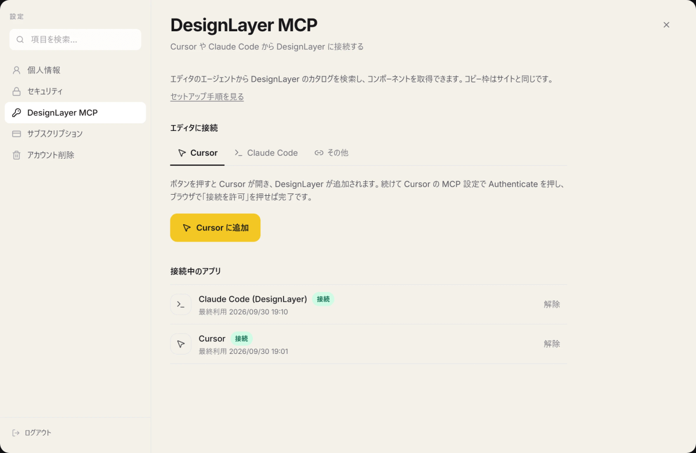

<p align="center">
  
</p>

<h1 align="center">designlayer-ui</h1>

<p align="center">Motion-first React components. Free and open source.</p>

<p align="center">
  
  
  
  
</p>

<p align="center">
  <a href="https://design-layer.com">Website</a>
  ·
  <a href="https://design-layer.com/en/components">Browse components</a>
  ·
  <a href="https://design-layer.com/en/blocks">Blocks & Templates</a>
</p>

## Why

- Motion is written in the component file you copy.
- Copy that file into your app. The source is MIT licensed.
- 69 of 101 components include a `prefers-reduced-motion` or `useReducedMotion` check.

## Quick start

```bash
npm install react react-dom tailwindcss lucide-react clsx motion tailwind-merge
```

1. Copy `components/buttons-toggles/like-heart-button.tsx` into your project.
2. Copy `lib/utils.ts`. It exports `cn`.
3. Import the component.

```tsx
import { LikeHeartButton } from "@/components/buttons-toggles/like-heart-button";

export function Example() {
  return <LikeHeartButton defaultCount={128} />;
}
```

## Components

<details>
<summary>Buttons & Toggles (9)</summary>

| Component | Description |
| --- | --- |
| [Bookmark Save Toggle](https://design-layer.com/en/components/buttons-toggles/bookmark-save-toggle) | A white pill save button: a bookmark icon and a label. |
| [Clipboard Copy Button](https://design-layer.com/en/components/buttons-toggles/clipboard-copy-button) | A white pill copy button. |
| [Follow Pill Button](https://design-layer.com/en/components/buttons-toggles/follow-pill-button) | A white pill that reads “Follow”. |
| [Like Heart Button](https://design-layer.com/en/components/buttons-toggles/like-heart-button) | A white pill like button: one heart and a count. |
| [Lock Toggle](https://design-layer.com/en/components/buttons-toggles/lock-toggle) | A pill with a padlock and a short label. |
| [Magnetic CTA Button](https://design-layer.com/en/components/buttons-toggles/magnetic-cta-button) | A white glass pill CTA. |
| [Pin Toggle](https://design-layer.com/en/components/buttons-toggles/pin-toggle) | A white pill with a pin and a short label. |
| [Play Pause Button](https://design-layer.com/en/components/buttons-toggles/play-pause-button) | Just the play/pause button: a black circle inside a white ring. |
| [Thumb Vote Pair](https://design-layer.com/en/components/buttons-toggles/thumb-vote-pair) | A white pill with thumbs up and thumbs down. |

</details>

<details>
<summary>Switches & Selectors (11)</summary>

| Component | Description |
| --- | --- |
| [Color Swatch Row](https://design-layer.com/en/components/switches-selectors/color-swatch-row) | A white tile with a row of round color swatches for picking an accent or label color. |
| [Count Stepper](https://design-layer.com/en/components/switches-selectors/count-stepper) | A white pill stepper for seats or quantity: minus, the number, plus. |
| [Filter Chip Row](https://design-layer.com/en/components/switches-selectors/filter-chip-row) | A horizontal row of filter chips with counts. |
| [Interval Seg Control](https://design-layer.com/en/components/switches-selectors/interval-seg-control) | A compact range switch for dashboards: 24h, 7d, 30d, and 90d on a soft gray track. |
| [Plan Pill Switch](https://design-layer.com/en/components/switches-selectors/plan-pill-switch) | A white pill switch. |
| [Rating Star Row](https://design-layer.com/en/components/switches-selectors/rating-star-row) | A five-star rating row with a word beside it, from Poor to Excellent. |
| [Soft Switch](https://design-layer.com/en/components/switches-selectors/soft-switch) | A small on/off switch with a label. |
| [Theme Mode Switch](https://design-layer.com/en/components/switches-selectors/theme-mode-switch) | A compact header switch for Light, Dark, and System, drawn as three icons in a pill. |
| [Underline Tab Switch](https://design-layer.com/en/components/switches-selectors/underline-tab-switch) | Text tabs with a thin underline that slides and resizes to the selected tab. |
| [View Mode Switch](https://design-layer.com/en/components/switches-selectors/view-mode-switch) | A white pill switch between List and Grid. |
| [Volume Pill Slider](https://design-layer.com/en/components/switches-selectors/volume-pill-slider) | A white pill volume control: a speaker button and a short track. |

</details>

<details>
<summary>Form fields (10)</summary>

| Component | Description |
| --- | --- |
| [API Key Field](https://design-layer.com/en/components/form-fields/api-key-field) | A masked secret-key field: a key badge, the prefix and last four characters (sk_live_••••••••4242), a reveal toggle, and a copy button. |
| [Avatar Upload Ring](https://design-layer.com/en/components/form-fields/avatar-upload-ring) | A round avatar with an optional progress ring. |
| [File Drop Card](https://design-layer.com/en/components/form-fields/file-drop-card) | A compact “Drop files to attach” tile: a paperclip, a short hint, and an “or browse” link inside a dashed well. |
| [File Upload](https://design-layer.com/en/components/form-fields/file-upload-panel) | An empty folder card on a green-hills photograph: a still life of an envelope, a loose sheet, and a stone, then a title, description, and Start over plus Add a file. |
| [Handle Availability Field](https://design-layer.com/en/components/form-fields/handle-availability-field) | A username field with a fixed prefix such as designlayer.com/ or @. |
| [Invite Email Field](https://design-layer.com/en/components/form-fields/invite-email-field) | A white pill with an email field and a black Invite button. |
| [Member Role Select](https://design-layer.com/en/components/form-fields/member-role-select) | A compact role picker for a members row. |
| [OTP Digit Input](https://design-layer.com/en/components/form-fields/otp-digit-input) | A six-box verification code field. |
| [Password Strength Field](https://design-layer.com/en/components/form-fields/password-strength-field) | A password field with a show/hide toggle and a three-segment meter underneath. |
| [Tag Input Row](https://design-layer.com/en/components/form-fields/tag-input-row) | A text field that turns what you type into chips. |

</details>

<details>
<summary>Feedback & States (5)</summary>

| Component | Description |
| --- | --- |
| [Notice Count Badge](https://design-layer.com/en/components/feedback-states/notice-count-badge) | A round bell button with a red count badge that caps at 99+. |
| [Pixel Arc Loader](https://design-layer.com/en/components/feedback-states/pixel-arc-loader) | A full-screen loader with a blurred landscape behind an arched 3D pixel logo. |
| [Progress Steps](https://design-layer.com/en/components/feedback-states/progress-steps) | A horizontal step indicator for 3 to 5 steps, such as Account, Plan, and Checkout. |
| [Spring Toast Stack](https://design-layer.com/en/components/feedback-states/spring-toast-stack) | A toast stack for app feedback. |
| [What's New Card](https://design-layer.com/en/components/feedback-states/whats-new-card) | A compact what’s-new card for the bottom-right of a dashboard. |

</details>

<details>
<summary>App navigation (6)</summary>

| Component | Description |
| --- | --- |
| [Account Menu](https://design-layer.com/en/components/app-navigation/settings-save-panel) | An account menu for a SaaS header, with a plan line and an Upgrade button. |
| [Center Plus Tab Bar](https://design-layer.com/en/components/app-navigation/center-plus-tab-bar) | A floating white pill tab bar on a light gray canvas. |
| [Command K Hint](https://design-layer.com/en/components/app-navigation/command-k-hint) | A compact search trigger for a header: a search icon, a quiet label, and keycaps that read ⌘K on Apple devices and Ctrl K elsewhere. |
| [Glass Sidebar Nav](https://design-layer.com/en/components/app-navigation/glass-sidebar-nav) | A full-viewport dark abstract sculpture wallpaper with a tall frosted-glass sidebar on top: macOS traffic-light dots, a centered brand wordmark, MENU and secondary rows, and an account footer. |
| [Household Sidebar Shell](https://design-layer.com/en/components/app-navigation/household-sidebar-shell) | A light, flat sidebar for a finance app. |
| [Spring Command Palette](https://design-layer.com/en/components/app-navigation/spring-command-palette) | A command palette React UI: a ⌘K search modal React teams can paste in like a react cmdk component. |

</details>

<details>
<summary>Calendar & Scheduling (5)</summary>

| Component | Description |
| --- | --- |
| [Booking Slot Picker](https://design-layer.com/en/components/calendar-scheduling/booking-slot-picker) | A white booking panel: a host row that reads “30 min intro call with Aiko Mori”, a seven-day date strip with previous and next week, a grid of open 30-minute slots, and the time zone. |
| [Day Agenda Timeline](https://design-layer.com/en/components/calendar-scheduling/day-agenda-timeline) | A white day view on a vertical hour axis from 9:00 to 18:00. |
| [Month Calendar Card](https://design-layer.com/en/components/calendar-scheduling/month-calendar-card) | A quiet month calendar on a plain white card. |
| [Month Pager](https://design-layer.com/en/components/calendar-scheduling/month-pager) | A white pill month pager: previous, the month and year, next. |
| [Monthly Calendar](https://design-layer.com/en/components/calendar-scheduling/album-calendar) | A full-screen monthly calendar over a grassy hill and towering cloud. |

</details>

<details>
<summary>Tables & Lists (9)</summary>

| Component | Description |
| --- | --- |
| [File Browser Panel](https://design-layer.com/en/components/tables-lists/file-browser-panel) | A white file browser. |
| [Kanban Board Lanes](https://design-layer.com/en/components/tables-lists/kanban-board-lanes) | A white kanban board with three lanes: Todo, In progress, and Done. |
| [Notification Inbox Panel](https://design-layer.com/en/components/tables-lists/notification-inbox-panel) | A white inbox with clear unread states. |
| [OKR Goals Panel](https://design-layer.com/en/components/tables-lists/okr-goals-panel) | A white quarterly-goals table. |
| [Orders Table Panel](https://design-layer.com/en/components/tables-lists/orders-table-panel) | A white orders panel. |
| [Permissions Matrix Panel](https://design-layer.com/en/components/tables-lists/permissions-matrix-panel) | A white roles-and-permissions grid. |
| [Search Results Panel](https://design-layer.com/en/components/tables-lists/search-results-panel) | A white in-app search panel. |
| [Team Members Table](https://design-layer.com/en/components/tables-lists/team-members-table) | A members table for team pages. |
| [Transaction Ledger List](https://design-layer.com/en/components/tables-lists/transaction-ledger-list) | A payment history list with a details view. |

</details>

<details>
<summary>Panels & Drawers (8)</summary>

| Component | Description |
| --- | --- |
| [Billing Seats Panel](https://design-layer.com/en/components/panels-drawers/billing-seats-panel) | A review-and-confirm card for changing seats. |
| [Checkout Summary Panel](https://design-layer.com/en/components/panels-drawers/checkout-summary-panel) | A white checkout summary. |
| [Comment Thread Panel](https://design-layer.com/en/components/panels-drawers/comment-thread-panel) | A light comment thread for the margin of a document. |
| [Email Compose Sheet](https://design-layer.com/en/components/panels-drawers/email-compose-sheet) | A white compose sheet: a To field with removable recipient chips that you add with Enter, a subject, a body, an attachment chip for q4-plan.pdf, and Send. |
| [Invoice Editor Panel](https://design-layer.com/en/components/panels-drawers/invoice-editor-panel) | A white invoice editor. |
| [Issue Detail Drawer](https://design-layer.com/en/components/panels-drawers/issue-detail-drawer) | A white panel with a compact issue list and a detail drawer. |
| [Night Messenger Chat](https://design-layer.com/en/components/panels-drawers/night-messenger-chat) | A desktop messenger window over a night mountain wallpaper: icon rail, search, stories, starred threads, chat bubbles, and a composer. |
| [Profile Header Section](https://design-layer.com/en/components/panels-drawers/profile-header-section) | A white profile header: a flat muted cover with an overlapping avatar, the name, handle, and a short bio, stats for Followers 2,481, Following 312, and Projects 27, and Message and Follow buttons. |

</details>

<details>
<summary>Workflow cards (7)</summary>

| Component | Description |
| --- | --- |
| [Approval Queue Card](https://design-layer.com/en/components/workflow-cards/approval-queue-card) | A white approval tile: a queue count, the requester with their team, a one-line summary, small detail chips, and Decline / Approve buttons. |
| [Domain Verify Card](https://design-layer.com/en/components/workflow-cards/domain-verify-card) | A white custom-domain tile: the hostname, a status pill, and one DNS record row with type, host, and value. |
| [Feature Flag Card](https://design-layer.com/en/components/workflow-cards/feature-flag-card) | A dark feature-flag tile: an environment pill, the flag key in mono, a short description, and a square-cornered switch. |
| [Invoice Status Card](https://design-layer.com/en/components/workflow-cards/invoice-status-card) | A white invoice tile: the customer, invoice number, amount due, date, and a status pill for Open, Paid, or Overdue. |
| [Onboarding Checklist Card](https://design-layer.com/en/components/workflow-cards/onboarding-checklist-card) | A white “Get started” tile with a progress fraction such as 3 of 5, a thin progress bar, and a short checklist. |
| [Session Device Card](https://design-layer.com/en/components/workflow-cards/session-device-card) | A white security tile listing signed-in devices: a laptop, phone, desktop, or tablet icon, the device and browser, the location, and when it was last active. |
| [Support Ticket Card](https://design-layer.com/en/components/workflow-cards/support-ticket-card) | A white helpdesk tile: the ticket number, a priority pill, the subject, and the customer’s latest message as a quote. |

</details>

<details>
<summary>Charts (11)</summary>

| Component | Description |
| --- | --- |
| [Area Tooltip Card](https://design-layer.com/en/components/charts/area-tooltip-card) | A white KPI tile with a fourteen-day filled area chart, a quiet baseline, a few date ticks, and a tooltip. |
| [Country Sessions Card](https://design-layer.com/en/components/charts/country-sessions-card) | A white card of five country rows: a two-letter code chip, a name, a session count, and a soft bar behind each row. |
| [Donut Share Card](https://design-layer.com/en/components/charts/donut-share-card) | A white card with a three-segment donut, a total in the hole, and a compact legend. |
| [Funnel Steps Card](https://design-layer.com/en/components/charts/funnel-steps-card) | A white card with a compact four-step funnel: each step is a rounded bar sized to its count, with a label and a number. |
| [Latency Heat Card](https://design-layer.com/en/components/charts/latency-heat-card) | A dark latency card with one row per region (US, EU, APAC by default). |
| [MRR Waterfall Card](https://design-layer.com/en/components/charts/mrr-waterfall-card) | A white MRR tile with a seven-column waterfall: Start, New, Expand, Renew, Contract, Churn, and End. |
| [Radial Score Gauge](https://design-layer.com/en/components/charts/radial-score-gauge) | A white score card with a bottom-open dial, tick marks, and a needle. |
| [Rank Bar List](https://design-layer.com/en/components/charts/rank-bar-list) | A white ranked list of five rows: a rank number, a name, a count, and a thin bar under each. |
| [Stacked Share Bar](https://design-layer.com/en/components/charts/stacked-share-bar) | A white card with a title, one horizontal 100% stacked bar, and a four-row legend with percents. |
| [Value Histogram Card](https://design-layer.com/en/components/charts/value-histogram-card) | A white distribution card: a label, a sample size, and eight columns with a range under each. |
| [Week Heatmap Strip](https://design-layer.com/en/components/charts/week-heatmap-strip) | A white card with a seven-column, twelve-week grid of rounded cells in five shades of green, plus a title and a total. |

</details>

<details>
<summary>Metrics & KPIs (10)</summary>

| Component | Description |
| --- | --- |
| [Bar KPI Card](https://design-layer.com/en/components/metrics-kpis/bar-kpi-card) | A white KPI tile: a label, a big figure, a delta pill, and a row of twelve vertical bars. |
| [Budget Burn Card](https://design-layer.com/en/components/metrics-kpis/budget-burn-card) | A white spend-versus-budget tile: a label, the amount spent, the budget, a linear bar, and a row for burn rate and days left. |
| [Conversion Rate Ring](https://design-layer.com/en/components/metrics-kpis/conversion-rate-ring) | A white card built around one rate: a thin closed ring, a large percent in its center, and a line like 448 of 12,440 visits. |
| [Count-Up Trend Stat](https://design-layer.com/en/components/metrics-kpis/countup-trend-stat) | The quietest white stat card: a label, one large figure, a trend pill, and a short caption, with no chart. |
| [Goal Progress Ring](https://design-layer.com/en/components/metrics-kpis/goal-progress-ring) | A white goal card: a label, the amount reached, the target, and a closed ring with the percent in its center. |
| [NPS Score Card](https://design-layer.com/en/components/metrics-kpis/nps-score-card) | A white NPS tile: a label, the response count, a large score, and a three-part bar for promoters, passives, and detractors. |
| [P95 Latency Card](https://design-layer.com/en/components/metrics-kpis/p95-latency-card) | A white latency tile: a label, a figure like 184 ms, a small delta, and a mini band chart with the p95 line on top of a p50–p95 band. |
| [Period Compare Card](https://design-layer.com/en/components/metrics-kpis/period-compare-card) | A white comparison tile: a label, a big figure, a delta pill, and two columns for last period and this period. |
| [Sparkline KPI Card](https://design-layer.com/en/components/metrics-kpis/sparkline-kpi-card) | A white KPI tile: a label, a big figure, a delta pill, and a small sparkline. |
| [Storage Split Meter](https://design-layer.com/en/components/metrics-kpis/storage-split-meter) | A white storage tile: a label, the amount used out of the total, one linear bar split by type, and a legend. |

</details>

<details>
<summary>Status & Monitoring (10)</summary>

| Component | Description |
| --- | --- |
| [AI Generating Card](https://design-layer.com/en/components/status-monitoring/ai-generating-card) | A dusk-toned AI tile. |
| [Deploy Tick Card](https://design-layer.com/en/components/status-monitoring/deploy-tick-card) | A dark deploy card with the environment, a short commit hash, the domain, and a thin progress bar. |
| [Event Stream Card](https://design-layer.com/en/components/status-monitoring/event-stream-card) | A dark webhook feed: event names like invoice.paid and charge.failed, each with a tone dot, its age, and an HTTP status. |
| [Presence Stack Card](https://design-layer.com/en/components/status-monitoring/presence-stack-card) | A white presence tile for a shared doc or board: a title, overlapping teammate avatars with status dots, a “3 online” pill with a live ping, and who is doing what. |
| [Source Flow Card](https://design-layer.com/en/components/status-monitoring/source-flow-card) | Three labeled rows on the left (Banks, Ledger, Billing) send small glowing dots along thin lines into a white hub with a dotted spinner. |
| [Status Pipeline Card](https://design-layer.com/en/components/status-monitoring/status-pipeline-card) | A dark job card with a vertical pipeline: Queued, Running, Done. |
| [Sync Pulse Card](https://design-layer.com/en/components/status-monitoring/sync-pulse-card) | A dark list of connected sources that syncs one row at a time. |
| [Uptime Day Strip](https://design-layer.com/en/components/status-monitoring/uptime-day-strip) | A white reliability tile: a label, a big uptime figure, and a slim strip of ninety daily ticks. |
| [Uptime Signal Card](https://design-layer.com/en/components/status-monitoring/uptime-signal-card) | A dark status card with a large uptime figure (99.99% by default) above a row of daily ticks. |
| [Usage Meter Card](https://design-layer.com/en/components/status-monitoring/usage-meter-card) | A white usage card with a 270° meter, such as 12 of 20 seats. |

</details>

## Need more?

[Blocks](https://design-layer.com/en/blocks) and [Templates](https://design-layer.com/en/templates) are on design-layer.com.

## License

MIT © designlayer
